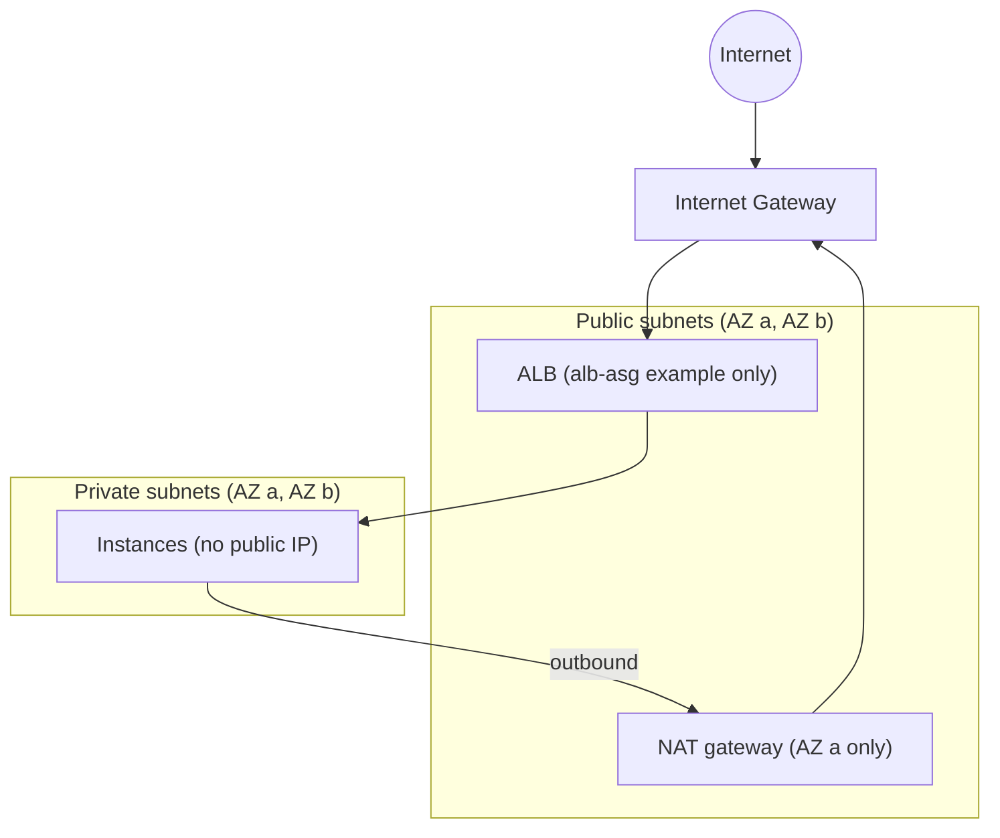

# AWS VPC Networking with Terraform


Entry-level AWS networking and compute basics in Terraform: a reusable VPC module, two
examples built on it, and one small read-only boto3 script. Everything is destroyable and
meant to be applied one example at a time.

## Verified

Each line links to the redacted output that shows it. The examples were run in us-east-1 on
2026-10-22 and then destroyed. ssm-private-ec2 was applied once. alb-asg was applied twice:
the first run was destroyed before any check was saved, and all alb-asg evidence below comes
from the second run. They were applied with a role that has broader
permissions than these examples need (temporary credentials), not with a least-privilege
policy; this repository does not define the minimum policy. `111111111111`, `203.0.113.1`,
`alb-redacted.us-east-1.elb.amazonaws.com` and `<kind>-REDACTED-N` are fictitious
placeholders written by the redaction step in [docs/RUNBOOK.md](docs/RUNBOOK.md).

`examples/ssm-private-ec2`:

- The instance registered with SSM (ping status Online):
  [ex1-ssm-instance-info.txt](docs/evidence/ex1-ssm-instance-info.txt)
- A command sent through SSM finished with status Success and printed `egress-ok`:
  [ex1-ssm-command.txt](docs/evidence/ex1-ssm-command.txt)
- No public IP, IMDSv2 required, gp3 root volume encrypted, security group with no inbound
  rules and outbound TCP 443 only:
  [ex1-instance-hardening.txt](docs/evidence/ex1-instance-hardening.txt)
- Flow log ACTIVE, destination CloudWatch Logs, delivery status SUCCESS:
  [ex1-flow-logs.txt](docs/evidence/ex1-flow-logs.txt). Log group retention 7 days:
  [ex1-log-group-retention.txt](docs/evidence/ex1-log-group-retention.txt)
- Delivery to CloudWatch verified: records for the network interface reached the log group.
  The records read were NODATA records, so no traffic was observed:
  [ex1-flow-log-event.txt](docs/evidence/ex1-flow-log-event.txt)

`examples/alb-asg`:

- Auto Scaling Group with min 2, desired 2, max 3, two instances in two zones, both Healthy
  and InService: [ex2-asg-initial.txt](docs/evidence/ex2-asg-initial.txt)
- Ten requests through the load balancer were answered by both instances (one per zone):
  [ex2-curl-before.txt](docs/evidence/ex2-curl-before.txt)
- After one instance was terminated by hand, the group launched a replacement and returned
  to two Healthy, InService instances:
  [ex2-scaling-activities.txt](docs/evidence/ex2-scaling-activities.txt),
  [ex2-asg-recovered.txt](docs/evidence/ex2-asg-recovered.txt). Ten requests were then
  answered by the surviving and the new instance:
  [ex2-curl-after.txt](docs/evidence/ex2-curl-after.txt)
- No public IP and IMDSv2 required on the instances:
  [ex2-instances.txt](docs/evidence/ex2-instances.txt)
- Flow log ACTIVE, delivery status SUCCESS:
  [ex2-flow-logs.txt](docs/evidence/ex2-flow-logs.txt)
- The encrypted volumes and the security group rules of this example are checked in code
  only (`examples/alb-asg/main.tf`); there is no evidence file for them.

Tag audit (`scripts/find_untagged.py`, scans the whole region; resource counts are in
[ex1](docs/evidence/ex1-region-resource-counts.txt) and
[ex2](docs/evidence/ex2-region-resource-counts.txt)):

- Required tags `Project,Environment`: "No findings", exit code 0:
  [ex1](docs/evidence/ex1-find-untagged-ok.txt),
  [ex2](docs/evidence/ex2-find-untagged-ok.txt)
- With `CostCenter` also required: instances and volumes listed, exit code 1:
  [ex1](docs/evidence/ex1-find-untagged-finding.txt),
  [ex2](docs/evidence/ex2-find-untagged-finding.txt)

Destroy:

- `scripts/check-leftovers.ps1` reported "nothing left" right after destroy and again after
  about three minutes: [ex1 after destroy](docs/evidence/ex1-leftovers-after-destroy.txt),
  [ex1 after 3 min](docs/evidence/ex1-leftovers-after-3min.txt),
  [ex2 after destroy](docs/evidence/ex2-leftovers-after-destroy.txt),
  [ex2 after 3 min](docs/evidence/ex2-leftovers-after-3min.txt)
- The flow log group was not recreated after destroy, checked about three minutes later:
  [ex1](docs/evidence/ex1-log-group-after-3min.txt),
  [ex2](docs/evidence/ex2-log-group-after-3min.txt)
- Final check of both projects after both destroys:
  [final-leftovers.txt](docs/evidence/final-leftovers.txt)

## Limitations

- Single NAT gateway, in the first availability zone. If that zone fails, private subnets in
  the other zone lose outbound internet access. Egress has a single point of failure.
- The `alb-asg` load balancer is public and serves HTTP only. There is no HTTPS, no
  certificate and no domain. Access is limited by `allowed_ingress_cidrs`, which is required,
  has no default and rejects any `/0` CIDR.
- Terraform state is local and git-ignored. There is no remote backend.
- IAM is not scoped per resource. The permissions used to run Terraform are not defined in
  this repository.
- The flow log group was re-checked only at about three minutes after destroy, plus the final
  check. The final check ran about 39 minutes after the ssm-private-ec2 destroy check and
  about 5 minutes after the alb-asg destroy check. Later behavior is not shown.
- The flow log records seen were NODATA; no traffic capture is shown.
- Evidence comes from a single run of each example (alb-asg had an earlier run with no
  evidence saved). Behavior of the NAT gateway or an availability zone failing was not tested.
- Not shown here: autoscaling policies, monitoring or alarms, backups, multi-region.

## Contents

| Path | What it is |
|---|---|
| `modules/vpc` | VPC with two public and two private subnets in two availability zones, one NAT gateway, VPC Flow Logs to a CloudWatch log group with 7-day retention |
| `examples/ssm-private-ec2` | One EC2 instance in a private subnet: no public IP, no port 22, managed through AWS Systems Manager (SSM), IMDSv2 required, encrypted gp3 root volume |
| `examples/alb-asg` | Public Application Load Balancer in front of an Auto Scaling Group (min 2, desired 2) in private subnets across two availability zones. Each instance serves a page with its instance id and availability zone, read with IMDSv2 |
| `scripts/find_untagged.py` | Read-only boto3 script: lists EC2 instances and EBS volumes missing required tag keys. Exit code 1 when findings exist |
| `scripts/check-leftovers.ps1` | Read-only check for resources that survive `terraform destroy` |
| `docs/RUNBOOK.md` | Ordered commands to deploy, verify, collect evidence and destroy |
| `tests/` | pytest tests for the script, using moto |

## Architecture



## Usage

Requires Terraform >= 1.5.0 and AWS credentials for apply. Each example keeps local state.

```bash
cd examples/ssm-private-ec2        # or examples/alb-asg
cp terraform.tfvars.example terraform.tfvars   # alb-asg: set allowed_ingress_cidrs to your own IP
terraform init
terraform plan
terraform apply
terraform destroy
```

For the full ordered procedure, evidence collection and redaction, follow
[docs/RUNBOOK.md](docs/RUNBOOK.md). Local checks: `terraform fmt -check`,
`terraform init -backend=false`, `terraform validate`, `tflint`, `tfsec`,
`python -m pytest` (dependencies in `requirements.txt`).

## tfsec ignores

Four rules are ignored, each on the resource it applies to:

- `aws-cloudwatch-log-group-customer-key` in `modules/vpc/main.tf`: the log group uses the
  default CloudWatch Logs encryption at rest. A customer-managed KMS key would survive
  `terraform destroy` for its deletion window, which conflicts with a clean destroy.
- `aws-iam-no-policy-wildcards` in `modules/vpc/main.tf`: the flow log policy is limited to
  three log actions on the log group ARN with `:*`, because log stream names are generated by
  the service.
- `aws-elb-alb-not-public` in `examples/alb-asg/main.tf` on `aws_lb.this`: the load balancer is public on purpose; this is
  the point of the example, and ingress is restricted to `allowed_ingress_cidrs`.
- `aws-elb-http-not-used` in `examples/alb-asg/main.tf` on `aws_lb_listener.http`: HTTPS needs a certificate and a domain,
  which are out of scope for this example.

## Continuous integration

One workflow (`.github/workflows/terraform-ci.yml`): `terraform fmt -check`, `init
-backend=false`, `validate` and `tflint` for the module and each example, `tfsec`, and
`pytest`. It has no apply job and uses no AWS credentials.

CI (fmt, validate and tflint per directory, tfsec, pytest on Python 3.12) passed on `main` on 2026-10-22: [run 39769215380](https://github.com/Adonitologist/aws-terraform-network-foundations/actions/runs/39769215380).
